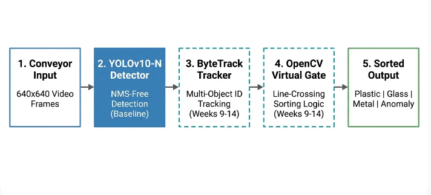

# mcta4364-yolov10-conveyor-sorting
MCTA 4364 Machine Vision
Project Title: Real-Time Vision-Based Simulated Conveyor Sorting System Using YOLOv10
## Team Members:
1) QASHRINA AISYA BINTI MOHD NAZARUDIN (2315184)
2) ALYA KHAIRAH BINTI KHAIRUL JAMIL (2317100)
3) NUREL HUMAIRAH BINTI MUHAMMAD FIRDAUS (2315680 ) 

## Track 2(Paper)   
Source Link (PDF): https://arxiv.org/abs/2405.14458
​GitHub Link: https://github.com/THU-MIG/yolov10


## Project Overview
This project develops a real-time vision-based object detection pipeline using **YOLOv10-N** to classify moving items on a simulated conveyor belt into four target categories: `plastic`, `glass`, `metal`, and `anomaly`. In Weeks 9–14, this baseline detector will be integrated with multi-object tracking (ByteTrack) and an OpenCV virtual sorting gate.

## System Architecture


## Repository Structure
```
├── assets/
│   └── pipeline_diagram.png       # End-to-end system pipeline diagram
├── notebooks/
│   └── 02_yolov10_baseline.ipynb  # YOLOv10-N training & evaluation on Colab T4
├── results/                       # YOLOv10-N baseline plots & qualitative examples
├── .gitignore
├── 01_dataset_eda.ipynb           # Dataset exploration & class distribution
├── README.md
└── requirements.txt
```
## DataSet EDA

Prerequisites :
1. A Google account with access to Google Colab.
2. A Roboflow account with access to the dataset workspace (custom-3w4p0), project (conveyor-belt-object-detection-ehaa8), and Version 9, along with a valid Roboflow API key.

Step 1: Store Your Roboflow API Key in Colab Secrets
Open your notebook in Google Colab.

1. Click the Secrets icon (key icon) on the left sidebar.
2. Click + Add new secret.
3. Set Name to ROBOFLOW_API_KEY and Value to your actual Roboflow API key (without quotation marks).
4. Toggle Notebook access to ON.

Step 2: Install Dependencies and Download the Dataset

Step 3: Run the EDA Script

Step 4: Download EDA Output Files and Notebook

1. Open the Files panel (folder icon) on the left sidebar of Google Colab.

2. Expand the eda_outputs/ folder and download the generated files:
    i. class_distribution.png
   ii. sample_1.jpg through sample_6.jpg

3. Download the notebook itself via File -> Download -> Download .ipynb (for example, saving it as 01_dataset_eda.ipynb).

Step 5: Clean Up Before Publishing to GitHub

1. Before pushing your notebook and files to GitHub:
Ensure no real API key or sensitive credentials are hardcoded in any code cell or cell output.

## Environment Setup

The YOLOv10-N baseline was developed and executed in **Google Colab** using an **NVIDIA Tesla T4 GPU** runtime (`Runtime -> Change runtime type -> T4 GPU`), which does not require local GPU drivers or manual CUDA installation.

Key dependencies installed in the notebook environment:
* **Python** (Google Colab default environment)
* **Ultralytics (`ultralytics`)** for YOLOv10-N (`yolov10n.pt`) training and test/validation evaluation
* **Roboflow (`roboflow`)** for downloading version 9 of `conveyor-belt-object-detection-ehaa8` (`custom-3w4p0`) in `yolov8` format

## How to Run the Baseline

1. Open `notebooks/02_yolov10_baseline.ipynb` in **Google Colab** and set the runtime to **T4 GPU** (`Runtime -> Change runtime type -> T4 GPU`).
2. Run the package installation cell (`!nvidia-smi` and `!pip install -q ultralytics roboflow`).
3. In the dataset download cell, replace `"YOUR_ROBOFLOW_API_KEY"` with your own Roboflow API key (from Roboflow **Settings -> Roboflow API**) and run the cell to download version 9 of `conveyor-belt-object-detection-ehaa8` in `yolov8` format.
4. Run the training and evaluation cell to fine-tune `yolov10n.pt` (`epochs=30`, `imgsz=640`, `batch=16`, `seed=42`, `plots=True`) and evaluate on the `test` split (falling back to `val` if no `test` split is present), reporting Precision, Recall, F1-Score, mAP@50, mAP@50-95, and inference speed (`ms/img`).
5. Run the export cell to zip `/content/runs/detect` into `baseline_results.zip` and download it to inspect plots (`confusion_matrix.png`, `PR_curve.png`, `results.png`) and prediction batches.
